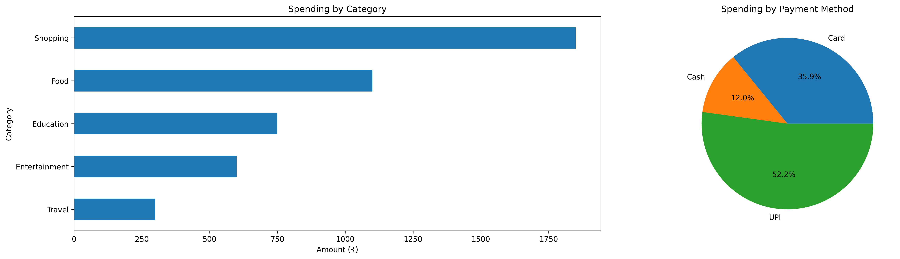
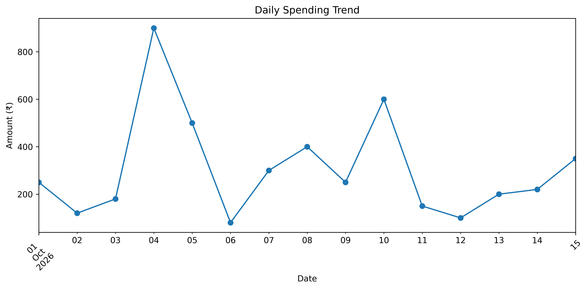

# 💰 Personal Expense Analyzer

A beginner-friendly Data Science project that analyzes expense transactions using Python, Pandas, NumPy, and Matplotlib.

The project explores spending patterns, compares payment methods, and visualizes expense categories using data analysis and charts.

## 📌 Project Overview

Understanding where money goes is an important part of personal finance. This project uses a sample expense dataset to demonstrate how Python can turn raw transaction data into useful insights.

## ✨ Features

- Load transaction data from a CSV file
- Inspect dataset structure and summary statistics
- Check for missing values
- Calculate total and average expenses
- Group and compare spending by category
- Analyze spending by payment method
- Filter transactions using multiple conditions
- Visualize results with bar charts and pie charts
- Generate a basic expense summary report


## 📊 Expense Dashboard



The dashboard compares spending across expense categories and payment methods.

## 📊 Daily Expense Dashboard



The dashboard compares spending across daily expense categories and payment methods.

## 🛠️ Technologies Used

- Python
- Pandas
- NumPy
- Matplotlib
- Jupyter Notebook

## 📂 Project Structure

```text
Personal-Expense-Analyzer/
├── expenses.csv
├── expense_analyzer.ipynb
└── README.md
```

## 🚀 Getting Started

### 1. Clone the repository

```bash
git clone https://github.com/codebynikhil08/Personal-Expense-Analyzer.git
cd Personal-Expense-Analyzer
```

### 2. Install the dependencies

```bash
pip install pandas numpy matplotlib jupyter
```

### 3. Run the notebook

```bash
jupyter notebook expense_analyzer.ipynb
```

Run the notebook cells from top to bottom.

## 📊 Key Findings

Based on the included sample dataset:

- Total expenses: ₹4,600
- Number of transactions: 15
- Average transaction amount: ₹306.67
- Highest spending category: Shopping — ₹1,850
- Lowest spending category: Travel — ₹300
- Highest-spending payment method: UPI — ₹2,400

## 📈 Visualizations

The notebook includes:
- Category-wise spending bar chart
- Payment-method spending pie chart

Screenshots of the generated charts can be added here.

## 🧠 What I Learned

- Loading and inspecting data using Pandas
- Grouping, filtering, sorting, and aggregating transactions
- Using NumPy for numerical operations
- Creating visualizations with Matplotlib
- Interpreting data and communicating findings
- Organizing a small Data Science project on GitHub

## ⚠️ Limitations

- The included dataset contains sample transactions.
- The analysis is descriptive and does not use a machine learning model.
- The findings are limited to the transactions in the dataset.

## 🔮 Future Improvements

- Add monthly spending trend analysis
- Improve data validation and cleaning
- Compare spending across time periods
- Add budget tracking and spending alerts
- Build an interactive dashboard

## 👨‍💻 Author

**Nikhil Sharma**

GitHub: [@codebynikhil08](https://github.com/codebynikhil08)

---

If you find this project useful, consider giving the repository a ⭐.
